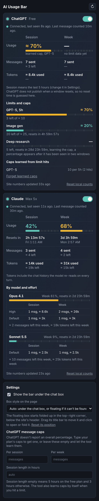
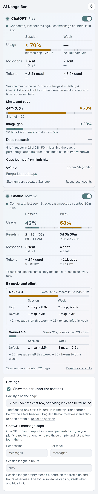
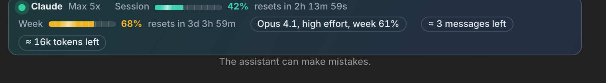
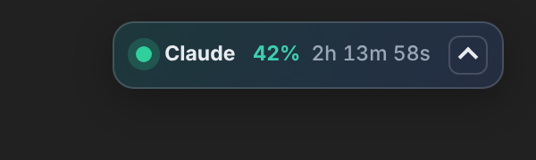
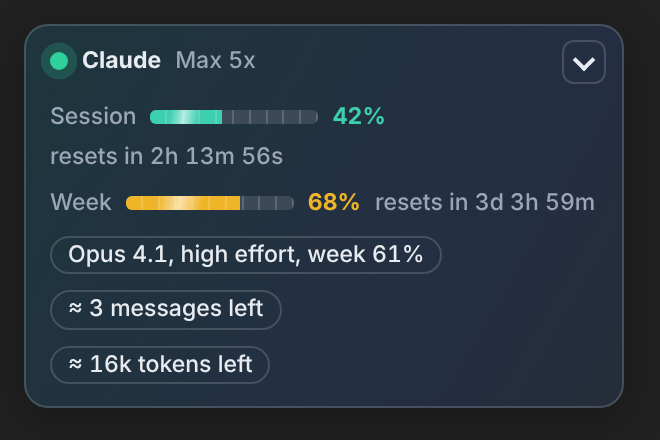
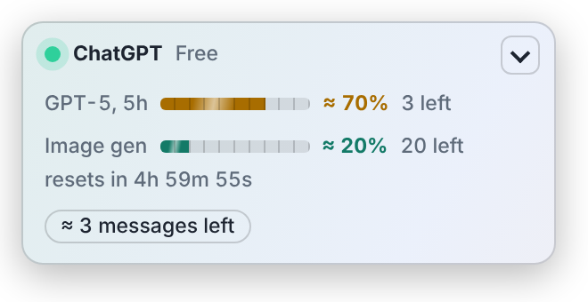
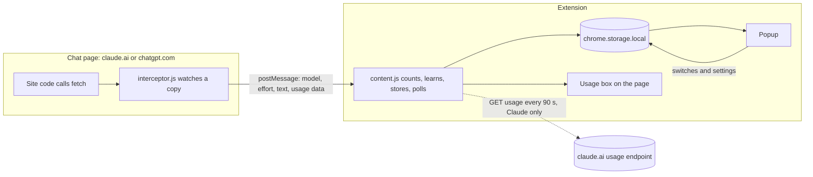
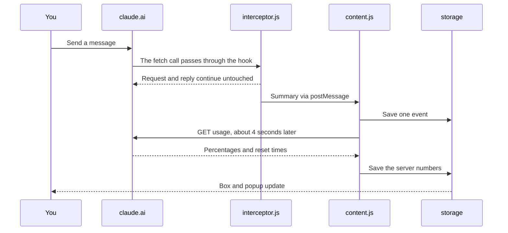

<div align="center">

# AI Usage Bar

### See how much of your Claude and ChatGPT limits you have used, and when they reset, without leaving the chat.


[1. Introduction](#1-introduction) &nbsp;•&nbsp;
[2. Use it and run it safely](#2-how-to-use-it-and-run-it-safely) &nbsp;•&nbsp;
[3. How it works](#3-deep-dive-how-it-works) &nbsp;•&nbsp;
[4. Security, scope and metadata](#4-security-scope-and-metadata)

</div>

---

# 1. Introduction

## The idea

Claude and ChatGPT both limit how much you can use them. Claude counts your usage in a **5-hour session** and a **7-day week**. ChatGPT counts messages per model in a window (its length is not published and has changed over time) and has separate limits for some features, such as image generation.

The problem is that you usually find out about these limits too late:

- **Claude** shows your usage, but only on a settings page you have to open on purpose.
- **ChatGPT** shows almost nothing until you hit the wall and get a "limit reached" message.

**AI Usage Bar puts this information where you already are.** It adds a small usage box to the chat page and a popup on the toolbar icon. The box has live countdowns, an animated look, and a status dot that tells you whether the extension itself is healthy.

## The goal

| Goal | What it means in practice |
|---|---|
| **See it at a glance** | One look at the box tells you how full your session and week are. |
| **Know when it resets** | A countdown that ticks every second, plus the clock time in the popup. |
| **Stay out of the way** | The box never covers the chat input. It sits under the chat box, or floats as a small box you can fold up and drag anywhere. |
| **Learn what the sites will not tell you** | ChatGPT does not publish its caps. The tool works them out from your own usage. |
| **Stay private** | Nothing leaves your computer. No account, no server, no tracking. |
| **Stay simple** | Plain JavaScript, no build step. Small enough to read. |

## What you get

| Feature | Claude | ChatGPT |
|---|---|---|
| Session usage (%) | Yes, exact | Learned from your own limit hits, or from a cap you type (shown as ≈) |
| Week usage (%) | Yes, exact | Only from a cap you type |
| Reset countdown | Yes, exact, ticking every second | For limits ChatGPT reports (such as image generation). Not guessed for the overall session. |
| Messages sent | Counted | Counted |
| Messages left | Estimated | From a learned or typed cap |
| Tokens used | Estimated, includes the chat so far | Exact for visible text (real tokenizer), includes the chat so far |
| Tokens left | Estimated | Not available |
| Breakdown by **model** and **effort** | Yes | Messages per model |
| Limits the site reports itself ("20 left") | n/a | Yes, with a percentage once the cap is known |
| Status dot (green / yellow / red) | Yes | Yes |
| On/off switch per site | Yes | Yes |

> [!NOTE]
> Some numbers are exact and some are estimates. Section 2 explains which is which, and why.

## Preview

The screenshots use made-up sample data.

**The toolbar popup**

<table>
  <tr>
    <td align="center"><b>Dark</b><br></td>
    <td align="center"><b>Light</b><br></td>
  </tr>
</table>

**The box on the chat page.** It has three looks:

<table>
  <tr>
    <td align="center" valign="top"><b>Under the chat box</b><br></td>
  </tr>
</table>

<table>
  <tr>
    <td align="center" valign="top"><b>Floating, folded</b><br></td>
    <td align="center" valign="top"><b>Floating, open (Claude)</b><br></td>
    <td align="center" valign="top"><b>Floating, open (ChatGPT, light)</b><br></td>
  </tr>
</table>

The tapes have a tick every 10%, light travels along them, the background drifts slowly, and a soft band of light sweeps across the box now and then. All of that stops if your system is set to "reduce motion".

## Is this for you?

**A good fit if you:**
- use Claude or ChatGPT heavily and keep hitting limits,
- like to see numbers instead of guessing,
- are comfortable loading a small extension from a folder.

**Not a good fit if you:**
- want a polished extension from the Chrome Web Store (this is a personal tool and is not published there),
- need exact token counts for Claude (Anthropic does not publish its tokenizer),
- want to track other people's accounts (it only reads your own).

---

# 2. How to use it and run it safely

## Requirements

- **Brave** (or any Chromium browser, version 111 or newer: Chrome, Edge, and so on)
- An account on [claude.ai](https://claude.ai), [chatgpt.com](https://chatgpt.com), or both

## Install (about 2 minutes)

1. **Get the code.** Either click **Code → Download ZIP** on GitHub and unzip it, or run:
   ```bash
   git clone https://github.com/YOUR-USERNAME/ai-usage-bar.git
   ```
2. Open `brave://extensions` in the address bar.
3. Turn on **Developer mode** (top right). This is needed because the extension is loaded from a folder.
4. Click **Load unpacked** and choose the `ai-usage-bar` folder, the one that contains `manifest.json`.
5. Click the puzzle-piece icon in the toolbar and **pin** AI Usage Bar.
6. **Refresh any Claude or ChatGPT tab that was already open.** Extensions only attach to pages loaded *after* they are installed.
7. Send a message. The box appears on the page.

> [!TIP]
> After you edit any file, go back to `brave://extensions`, click the reload arrow on the extension card, then refresh the chat tab.

## The status dot: is it working?

Every card in the popup, and the box on the page, has a dot next to the site name.

| Dot | Meaning |
|---|---|
| 🟢 **Green, pulsing slowly** | The extension is on and healthy. |
| 🟡 **Yellow, pulsing faster** | Something needs a look. Hover the dot (or read the line under the name in the popup) to see what. |
| 🔴 **Red** | You switched this site off. The popup shows it. On the page the box is hidden while a site is off. |

**What turns it yellow:**

- The extension has **not been seen on any page yet** (open or refresh the site).
- The page was found but the **network hook is not running** (reload the extension, then refresh the tab).
- **No open tab** for the site has been seen for more than about 2.5 minutes (open one to keep the numbers fresh).
- **Claude usage cannot be read** (check you are logged in, then press ↻).
- **Claude's numbers are more than 10 minutes old.**

## Using the popup

Click the toolbar icon. You will see one card per site.

| Control | What it does |
|---|---|
| **Status dot and line** (top of each card) | The dot colour above, plus a line such as "Connected, last seen 7s ago. Last message counted 10m ago." Check this first if nothing shows up. |
| **Switch** on a card | Turns tracking on or off for that site. When off, nothing is recorded and the box is hidden. Both start **on**. |
| **↻ button** (top right) | Re-reads your Claude usage right now. ChatGPT is updated by the page itself, so this does nothing there. |
| **Reset local counts** | Clears the message and token counts this extension collected for that site. It asks you to click twice. Numbers that come from the site are kept. |
| **Forget learned caps** (ChatGPT) | Throws away the caps the tool learned and starts again. |
| **Show the bar under the chat box** | Turns the on-page box on or off. The popup keeps working. |
| **Box style on the page** | **Auto** (under the chat box, or floating if it cannot be found), **Only under the chat box**, or **Always a small floating box**. |
| **Reset its position** | Puts the floating box back in its default corner. |
| **ChatGPT message caps** | Optional. Type your plan's caps (messages per session, and per week) to get exact percentages. Leave empty to let the tool learn them. |
| **Session length in hours** | The length of ChatGPT's session window. Empty means 5 hours on the free plan and 3 hours otherwise. |

## The box on the page

**Under the chat box (Auto).** A slim row appears right under the input. It is part of the page layout, so it pushes nothing over the input.

**Floating box.** If the chat box cannot be found (a site update moved it, or you are on a page without one), the box floats instead, after about 3 seconds. You can also choose this always in the popup.

- It starts **folded**: a small pill in the **top-right corner, below the site's header**, showing the dot, the fullest meter and a ticking countdown. Nothing else is covered.
- **Click the title bar** (or the small arrow) to open or fold it.
- **Drag the title bar** to move it anywhere. It remembers where you put it, per site.
- **Reset its position** in the popup puts it back.

**Live time.** Countdowns tick every second (for example `2h 13m 58s`). Above one day, seconds are dropped (`3d 3h 59m`). When a countdown reaches zero, the numbers refresh themselves.

## Reading the numbers

**Tape colours** tell you how full a window is:

| Colour | Usage | Meaning |
|---|---|---|
| Green | under 60% | Plenty left |
| Amber | 60% to 84% | Getting there |
| Red | 85% or more | Close to the limit |

**Small labels you will see:**

- **≈** means "estimated". Treat it as a rough guide.
- **from your cap** means the percentage came from the cap you typed in.
- **learned cap** means it came from a cap the tool worked out for you (see below).
- **learning the cap** means the tool has seen a limit only once so far and does not trust it yet.
- **Limit reached, resets in …** appears if the site refused your message because you hit a limit.

## Which numbers can you trust?

| Number | How reliable | Where it comes from |
|---|---|---|
| Claude session %, week %, per-model week %, reset times | **Exact** | Claude's own usage endpoint (the same one its Settings → Usage page uses) |
| ChatGPT "N left" for a feature (image generation, deep research, and so on) and its reset time | **Exact** | ChatGPT's own response when a chat loads |
| Percentage for one of those features | **≈ Estimate, improves over time** | The biggest "left" value ever seen is taken as the cap, trusted once seen in two different windows |
| ChatGPT message percentage and "messages left" | **≈ Estimate**, or exact if you type your cap | The number of messages you had sent when ChatGPT stopped you, or your typed cap |
| ChatGPT overall session or week reset time | **Not shown** | ChatGPT does not publish it, and a guess would mislead |
| Messages sent | **Exact for this browser** | Counted by the extension |
| Tokens used (ChatGPT) | **Exact for visible text, but incomplete** | OpenAI's real tokenizer. Hidden reasoning and system text are not visible, so real usage is higher. |
| Tokens used (Claude) | **Estimate**, roughly ±25% | A character-based guess, unless Claude's stream reports exact counts |
| Claude "messages left" and "tokens left" | **Estimate** | Your local counts scaled by Claude's percentage (see section 3) |

> [!IMPORTANT]
> **The extension only counts what *this browser* sees.** If you also use Claude or ChatGPT on your phone, in another browser, or with the extension switched off, those messages are not counted locally. Claude's percentages still include them because they come from Claude's servers. Local counts, learned caps and estimates do not.

## ChatGPT: limits and learned caps

ChatGPT does not publish how many messages you get, and the numbers change. So the tool learns them from what happens to you.

- **Limits ChatGPT reports.** Features like image generation come with an exact "N left" and a reset time. The tool shows them as meters.
- **Learned from limit hits.** When ChatGPT stops you with a real limit, the tool records how many messages of that model you had sent in the session window. That count is the cap. It uses the **highest of your last three hits** (so one odd hit does not skew it). After one hit, the model gets a percentage and a "messages left".
- **Learned from "mini" fallbacks.** ChatGPT quietly switches you to a smaller model when you pass a cap. If you asked for a specific model and a "mini" one answered, that counts as a hit.
- **Not fooled by short pauses.** A "slow down" error that clears in under 5 minutes is not a message cap, and pressing the same limit again within 10 minutes counts as one hit.
- **Your own caps win.** If you type a cap in Settings, it is used instead.

Because ChatGPT only sends the "N left" numbers when a chat loads, they refresh when you open a new chat or reload the page, not after every message.

## Claude: the model and effort breakdown

Under **By model and effort** you get one block per model you have used (for example "Opus 4.1"):

- A tape with that model's **weekly %** and when it resets. Claude reports this per model, so it is exact.
- One row per **effort level** you used, with messages and estimated tokens for the session and for the week.
- Estimated **messages and tokens left this week** for that model.

If Claude reports a weekly limit for a model you have not used yet in this browser, it still shows up, just without local counts.

## Run it safely

Because this extension runs on pages where you are logged in, take these precautions:

1. **Read the code before you load it.** It is about 2,300 lines of plain JavaScript, CSS and HTML (not counting the bundled tokenizer), with no build step. If you get a copy from somewhere else, compare it with this repository first.
2. **Only load it from a folder you trust.** Do not load a copy someone sent you in chat or email.
3. **Check the permissions.** On `brave://extensions` → **Details**, it should ask only for access to `claude.ai`, `chatgpt.com` and `chat.openai.com`. If a different copy asks for more (all websites, cookies, history), do not use it.
4. **Do not edit the permissions to "make it work everywhere".** It does not need to.
5. **Use it on your own account only.** It reads your own usage.
6. **Be careful on shared computers.** Counts are stored in the browser profile. Use **Reset local counts**, or remove the extension, when you are done.
7. **Turn off debug mode when you finish.** Debug mode logs the path of each site request and what the reply parser saw (never the content). If you used it, run `localStorage.removeItem('aub-debug')` in the page console.
8. **Do not make billing or plan decisions from the estimates.** Use Claude's and OpenAI's own pages for anything that matters.
9. **Remove it any time.** Removing the extension deletes its stored data.

## Troubleshooting

| What you see | Likely cause and fix |
|---|---|
| Yellow dot | Hover it, or read the status line in the popup. The list in "The status dot" above covers each case. |
| Popup says "No data yet" | Open the site, make sure the switch is on, and send a message. If you installed after opening the tab, refresh the tab. |
| No box on the page | Check **Show the bar** in the popup and the site switch. If the chat box cannot be found, the box floats (top-right, folded) after about 3 seconds. |
| The box is in the way | Drag it by its title bar, fold it with the arrow, or choose a different **Box style** in Settings. |
| Every effort says "Default" | The extension has not found the field that carries effort. See "Finding problems" below. |
| Claude numbers look old | Press **↻**. Numbers refresh every 90 seconds while the tab is visible. |
| ChatGPT shows no percentage | It is still learning. A percentage appears after a limit hit (messages) or after a limit has been seen in two windows (features). Or type your caps in Settings. |
| Token counts look too low | Open the popup: if it warns that the last reply was not captured, see "Finding problems". |
| Nothing works after a site update | The sites use internal endpoints that can change. Open the console and look for lines starting with `[AUB]`. |

### Finding problems

Turn on debug mode in the chat tab's console:

```js
localStorage.setItem('aub-debug', '1')
```

Then reload the tab and send a message. You will see, in the console:

- `[AUB] fetch POST /backend-api/...` for each site request the extension looks at, so you can see whether the message request is being recognised.
- `[AUB] request fields` with the field names of your request and **all long text hidden**. Use it to find the field that carries the effort level, and add its name to `EFFORT_KEY` in `src/interceptor.js`.
- `[AUB] reply captured: N characters from X stream lines, Y parsed events; model ...`. If N is 0 while X is large, the reply format has changed and the parser needs updating. The popup also shows a warning when the last reply captured 0 characters.

**Moving the box.** At the top of `src/content.js`, `CONFIG.anchors` lists the selectors that locate the chat box. Update them to match the site's current markup.

---

# 3. Deep dive: how it works

## The big picture, in plain words

A browser extension can run code inside a web page, but there is a catch: scripts in the page and scripts from an extension live in **two separate "rooms"** that cannot see each other's variables.

AI Usage Bar uses that on purpose, with one script in each room:

- **The listener (`interceptor.js`)** lives in the page's room. It can see the page's network calls, because it wraps the browser's `fetch` function. It only looks at *copies* of requests and replies. It never changes them.
- **The worker (`content.js`)** lives in the extension's room. It is allowed to save data, use the browser's extension features, and draw the box.

The listener passes short notes to the worker using `window.postMessage`. The worker stores the results, and the popup reads them.



## What each file does

| File | Role |
|---|---|
| `manifest.json` | Declares the extension: permissions, which sites it runs on, and which scripts load where. |
| `src/interceptor.js` | **The listener.** Wraps `fetch`, recognises chat messages, usage responses and conversation history, reads copies, and sends summaries to the worker. Also marks the page so the worker can confirm the hook is running. |
| `src/content.js` | **The worker.** Records events, learns caps, saves server numbers, polls Claude's usage, draws the box, ticks the clocks and reports a heartbeat. |
| `src/shared.js` | Logic shared by the page and the popup: data shapes, parsers for the site responses, the window, cap and estimate maths, the health check, time formatting and a small DOM helper. |
| `src/tokenizer.js` | Chooses the token counter: the real one on ChatGPT, a heuristic otherwise. |
| `src/vendor/gpt-tokenizer.js` | OpenAI's `o200k_base` tokenizer (MIT), bundled. Loaded on `chatgpt.com` only. |
| `src/styles.css` | Styles and animations for the on-page box (light and dark). |
| `src/popup.html`, `popup.css`, `popup.js` | The toolbar popup. It reads storage and writes only the switches and settings. |
| `icons/` | Toolbar and extension-page icons. |

Why are there several content scripts in the manifest? The listener must run **first**, before the site's own code, so it runs at `document_start` in the page's room (`"world": "MAIN"`). The worker runs in the extension's room, and on ChatGPT the tokenizer is loaded just before it.

## What happens when you send a Claude message



In words:

1. You press send. Claude's page calls `fetch` to a URL that ends in `/completion`.
2. The listener recognises that URL and takes a **copy** of the request and of the streamed reply.
3. From the request it reads the **model** and any **effort or thinking setting**. From the reply stream it reads the final model name and the text.
4. When the reply finishes (or you press stop), it sends one summary to the worker.
5. The worker counts the tokens (see below) and saves **one event**.
6. About 4 seconds later it asks Claude's usage endpoint for the real percentages and reset times, and saves those.
7. The box redraws. If the popup is open, it redraws too.

Messages the site **rejects** (for example when you are over the limit) are **not** counted as messages. If the rejection includes a reset time, the box shows "Limit reached, resets in …".

## What happens on ChatGPT

ChatGPT is **passive**. The extension makes no requests of its own to ChatGPT. It only listens to what the page already does:

- When a chat loads, ChatGPT sends your limits ("image generation: 20 left, resets in 5 hours"). The listener reads them.
- When you open an old chat, the page loads its history. The listener reads it (in memory only) to learn how big the chat is.
- When you send a message, it counts the message, reads the model name from the stream, and counts tokens.
- It also reads your plan name when the page loads it.

## Where the numbers come from

| Site | Endpoint (internal, undocumented) | Gives you |
|---|---|---|
| Claude | `GET /api/organizations/{id}/usage` | `five_hour` and `seven_day` (usage % and reset time), per-model weekly values such as `seven_day_opus`, and extra-usage info |
| Claude | `POST …/chat_conversations/{id}/completion` | Your message (model, effort) and the streamed reply |
| Claude | `GET …/chat_conversations/{id}` | The chat so far, when you open a chat |
| ChatGPT | `POST /backend-api/conversation/init` | `limits_progress`: feature name, how many remain, reset time |
| ChatGPT | `POST /backend-api/conversation` (or `/f/conversation`) | Your message and the streamed reply |
| ChatGPT | `GET /backend-api/conversation/{id}` | The chat so far, when you open a chat |
| ChatGPT | `GET /backend-api/accounts/check/…` | Your plan name |

<details>
<summary><b>Example: shape of Claude's usage response</b></summary>

```json
{
  "five_hour":        { "utilization": 42.0, "resets_at": "2026-11-17T12:00:00+00:00" },
  "seven_day":        { "utilization": 68.0, "resets_at": "2026-11-20T09:00:00+00:00" },
  "seven_day_opus":   { "utilization": 61.0, "resets_at": "2026-11-20T09:00:00+00:00" },
  "seven_day_sonnet": { "utilization": 9.0,  "resets_at": "2026-11-20T09:00:00+00:00" },
  "extra_usage":      { "is_enabled": false }
}
```

Any key that starts with `seven_day_` becomes a per-model row (except `seven_day_oauth_apps`, which is for third-party apps). A key the extension does not recognise is shown with a tidied-up name instead of being dropped.

</details>

**Finding your account ID (Claude).** The extension reads the `lastActiveOrg` cookie from the page. If it is missing, it asks `GET /api/organizations` and picks the matching organisation, or the first one that can chat. When it has to ask for the account list, it also reads your Claude plan name (for example "Max 5x") from it, so the plan label may not always appear. It also learns the ID from any request the page makes.

**How often it asks (Claude only):** about 1.5 seconds after the page loads, about 4 seconds after each message, when the site signals a limit change, when a countdown reaches zero, when you return to the tab, and every 90 seconds while the tab is visible and the switch is on.

## What is stored

Everything lives in `chrome.storage.local`, which stays in your browser profile.

| Key | Contents |
|---|---|
| `aub:settings` | On/off switches, "show the bar", box style, your ChatGPT caps and session length |
| `aub:state:claude` and `aub:state:chatgpt` | The event log, the latest numbers from the site, learned caps, chat sizes, and the last model and effort used |
| `aub:seen:claude` and `aub:seen:chatgpt` | A small heartbeat from an open tab: time, whether the hook is running, host name. Rewritten about every 30 seconds. |
| `aub:ui:claude` and `aub:ui:chatgpt` | The floating box: its position and whether it is open |

Each message becomes one **small event**. It contains only numbers and short names, **never the text of your messages or replies**:

```json
{ "t": 1763380000000, "m": "claude-opus-4-1-20250805", "e": "high", "i": 8600, "o": 6200, "a": 0 }
```

| Field | Meaning |
|---|---|
| `t` | Time the message was sent |
| `m` | Model name |
| `e` | Effort level (or `default`) |
| `i` | Input tokens: the chat so far plus your new message |
| `o` | Output tokens |
| `a` | `1` if the site reported the numbers, `0` if counted by the extension |

Alongside the events, the state keeps **chat sizes** (a random chat ID, a token count and a time, for up to 100 recent chats), **learned caps** (just numbers per model), and the **cap tracker** for ChatGPT's feature counters (numbers per feature name). No chat titles and no message text.

Events older than **8 days** are deleted automatically, and at most **4,000** are kept.

## How the session and week windows work

The extension decides which events belong to "this session" and "this week" like this:

| Situation | What it does |
|---|---|
| The site gave a reset time in the future (Claude) | Uses it. The window is the 5 hours (session) or 7 days (week) before that time. The % comes from the site. |
| The reset time has **passed** | Shows 0% and only counts events after the reset, until the next refresh brings fresh numbers. |
| No site data (Claude session) | Falls back to a local window that starts at your first message and lasts 5 hours. |
| ChatGPT session | A **rolling** window of your chosen length (5 hours on the free plan, 3 hours otherwise, unless you set it). **No reset time is shown**, because ChatGPT does not publish one. |
| ChatGPT or no site data (week) | A rolling 7 days of your own messages, with no reset time. |

## How tokens are counted

**Claude** does not publish its tokenizer, so `tokenizer.js` guesses by script, because different alphabets cost different amounts:

| Kind of character | Estimate |
|---|---|
| Plain ASCII / English letters | 1 token per 4 characters |
| Chinese, Japanese, Korean | 1 token per character |
| Emoji | 2 tokens each |
| Everything else (Arabic, Cyrillic, accented letters, and so on) | 1 token per 2.2 characters |

**ChatGPT** uses OpenAI's real `o200k_base` tokenizer (bundled in `src/vendor/`), so visible text is counted **exactly**.

**The whole chat, not just your new message.** The site re-reads the whole conversation on every turn, so a long chat costs far more than one short message. For each turn the extension counts:

```text
input tokens  =  the chat so far  +  your new message
```

It learns "the chat so far" in two ways: from the history the page loads when you open an old chat, and from its own running total as you chat. If the stream reports the real input size (Claude sometimes does), that is used instead and the event is marked exact (`"a": 1`).

**What is still missing.** Hidden reasoning, system instructions, tools and file processing are not visible from the browser. Real usage is therefore always somewhat higher than the counted number.

## How "messages left" and "tokens left" are estimated (Claude)

Claude tells you the **percentage** used, not the **size** of the limit. The extension works the size out from your own usage:

```text
total  ≈  used ÷ (percentage ÷ 100)
left   ≈  total − used
```

**Worked example:** you used about 6,000 tokens in this session and Claude says the session is 40% used.

```text
total ≈ 6,000 ÷ 0.40 = 15,000
left  ≈ 15,000 − 6,000 = 9,000 tokens
```

The same idea gives "messages left". It is only shown once at least **3%** is used (below that, tiny numbers make the maths wildly wrong). It is also skewed if you used Claude somewhere this browser did not see.

## How ChatGPT caps are learned

| Source | Rule |
|---|---|
| **Limit hit (HTTP 429)** | Only if the error says it clears in **more than 5 minutes** (shorter ones are "slow down" errors, not caps). The cap is the number of messages of that model sent in the session window. A message that mentions "week" is recorded as a weekly cap. |
| **Repeated hits** | Pressing the same limit again within **10 minutes** counts as one hit. The cap used is the **highest of the last three hits**. |
| **"Mini" fallback** | You asked for a specific model (not "Auto") and a "mini" model answered. This is treated as a hit. |
| **"N left" counters** | The highest "left" value ever seen for a feature is its cap, because a counter only goes down inside a window. It is trusted once seen in **two different windows**, and shown with ≈. |
| **Counter whose window already ended** | Shown as full again (it has refilled), with no reset time. |
| **Your typed cap** | Always wins over a learned one. |

## How effort and model are detected

- **Model:** taken from Claude's stream (`message_start`) or ChatGPT's stream (`model_slug`). If the stream does not say, it falls back to the model named in your request.
- **Effort:** the extension scans the request for any field whose name contains `effort`, `thinking`, `reasoning` or `paprika` (up to two levels deep). A field with "effort" in its name wins. Values like `true` or `enabled` become "thinking", and `none` or `off` become "off". If nothing is found, the effort is shown as "default".

The exact field names are not documented by either site, which is why this part is the most likely to need a tweak (see "Finding problems").

## How the reply is read

Both sites stream replies as many small pieces. The listener reassembles the text so it can be counted:

- **Claude** sends text deltas. It also sends the model name, and sometimes exact token counts.
- **ChatGPT** sends compact "patch" events. A bare piece of text means "append". An operation can append, or **replace** the whole text. A complete reply can also arrive nested inside a patch. The echo of your own message is ignored.
- Lines can be split across network chunks. They are reassembled before parsing.

Two bugs were found and fixed in this area: a "replace" operation used to be added on top of the streamed text (double counting), and a reply that arrived nested inside a patch used to be lost entirely (counted as 0 tokens). The popup warns if a reply is ever captured as empty.

## How the status dot decides

One function (`AUB.health`) is used by both the popup and the page:

```text
switched off                         → red    "Tracking is off"
never seen / hook missing            → yellow with the reason
no tab seen for more than 2.5 min    → yellow
Claude: usage unreadable or > 10 min → yellow
otherwise                            → green
```

A heartbeat from each open tab (every 30 seconds) tells the popup the page is alive. The hook marker is a small attribute that the listener sets on the page; the worker checks it from the other room.

## How the box stays in place

Both sites are single-page apps that re-draw the chat box often. The worker:

- finds the chat box with the selectors in `CONFIG.anchors`, then falls back to the largest visible text box in the lower part of the window, and inserts the slim row right after it,
- if neither is found, floats the box (top-right, folded) instead of hiding it, and moves it into place as soon as a chat box appears,
- watches the page for changes (throttled to about once every 0.4 seconds) and puts the box back if it was removed or the chat box moved,
- picks a light or dark style from the page's own theme, falling back to the background colour and then your system setting,
- redraws fully every 30 seconds, and updates only the clock text every second, so the clocks stay smooth without rebuilding the box.

## Reliability details

- **No lost updates.** Several events can arrive at once (for example two quick messages). Writes are queued one at a time inside the tab, and a Web Lock does the same across tabs of the same site.
- **Safe on extension reload.** If the extension is reloaded while a tab is open, errors from the old copy are caught and logged at debug level, so they never reach the page. Refresh the tab to attach the new copy.
- **Never breaks the page.** Every hook is wrapped so that if the extension fails, the site carries on normally.
- **Light on the page.** The ChatGPT tokenizer (about 2.7 MB) loads once per ChatGPT tab and parses in roughly a tenth of a second. Counting a very long text takes milliseconds.

---

# 4. Security, scope and metadata

## Security at a glance

| Question | Answer |
|---|---|
| Does it send my data anywhere? | **No.** No analytics, no remote server, no remote code. |
| Does it store my messages? | **No.** Message text is read in memory only to count tokens, then dropped. Only numbers, model names and random chat IDs are saved. |
| Does it change what I send or receive? | **No.** It reads copies of replies and never alters a request. |
| Does it make network requests itself? | **Only on claude.ai:** a `GET` to your own usage endpoint (and, if needed to find your account ID, `GET /api/organizations`), using your existing login. Nothing on ChatGPT. |
| Does it need my password or tokens? | **No.** It never reads or handles them. The `lastActiveOrg` cookie (an account ID, not a login) is read only to know which usage URL to call. |
| Does it work on other websites? | **No.** It is limited to `claude.ai`, `chatgpt.com` and `chat.openai.com`. |
| Does it load code from the internet? | **No.** The one library it uses is bundled in the repository. |

## Permissions, explained

| Permission | Why it is needed |
|---|---|
| `storage` | Save your settings, counts and the floating box position in the browser. |
| `https://claude.ai/*` | Run on Claude and call its usage endpoint. |
| `https://chatgpt.com/*` and `https://chat.openai.com/*` | Run on ChatGPT (the second is the older address). |
| Content scripts | Load the listener, worker, tokenizer and box styles on those pages only. |

**Not requested:** `tabs`, `cookies`, `webRequest`, `history`, `downloads`, `<all_urls>`, background scripts, or any remote code.

## The bundled library

| | |
|---|---|
| **Library** | [`gpt-tokenizer`](https://github.com/niieani/gpt-tokenizer) 4.1.2, `o200k_base` encoding only |
| **License** | MIT (copy in `src/vendor/LICENSE-gpt-tokenizer.txt`) |
| **Where it loads** | `chatgpt.com` and `chat.openai.com` only |
| **Size** | about 2.7 MB |
| **Why bundled, not downloaded** | The extension never loads code from the network. A bundled file can be read, diffed and pinned. |

## Data handling

- **Where:** your browser profile (`chrome.storage.local`). Nothing is synced or uploaded.
- **How long:** events and chat sizes older than 8 days are removed automatically.
- **How to delete it:** use **Reset local counts** and **Forget learned caps** for one site, or remove the extension to delete everything.

## Known limits and risks (read these)

> [!WARNING]
> **It relies on undocumented endpoints.** Claude's usage endpoint and ChatGPT's limits response are internal and not published as public APIs. They can change or disappear without notice. Using internal endpoints may not be covered by the sites' terms of service. This tool is meant for **personal use on your own account**, makes only one light read request, and you use it **at your own risk**.

- **Page scripts can send fake notes.** `window.postMessage` is open to any script on the same page. The worker checks the sender and a tag, but a hostile page script could still send fake events. The worst case is wrong **local counts**. It cannot read your storage or change your account.
- **Page scripts can see the same notes, and the box.** The listener passes message text to the worker through `postMessage`, and the box is ordinary page content. Scripts on the page could technically see both, but they already see the same text (it is their own request), and the box only holds numbers.
- **Estimates are not exact.** Learned caps can be too low if you used the service somewhere this browser did not see. See sections 2 and 3.
- **Only this browser is counted.** Usage on other devices does not appear in local counts.
- **Fragile by nature.** Site updates can move the chat box, rename fields or change the stream format.
- **Not independently audited.** It is a small personal project. Read the code.

## Scope

| In scope | Out of scope |
|---|---|
| Showing Claude session and week usage and resets | Sending messages, automating chats or bypassing limits |
| Showing ChatGPT counts, reported feature limits, and learned or typed caps | Exact token accounting (hidden tokens cannot be seen) |
| Per-model and per-effort breakdown for Claude | Per-effort breakdown for ChatGPT |
| A box that stays out of the way (inline or floating, foldable, draggable) | Changing or restyling the chat sites themselves |
| Light and dark themes, Brave and Chromium | Firefox and Safari (not tested) |
| Local-only storage | Syncing, accounts, sharing or cloud backup |
| Your own account | Team dashboards or tracking other users |

## Project metadata

| | |
|---|---|
| **Name** | AI Usage Bar |
| **Version** | 0.3.0 (early) |
| **Type** | Browser extension, Manifest V3 |
| **Browsers** | Brave and other Chromium browsers, version 111 or newer |
| **Languages** | JavaScript, HTML, CSS |
| **Size of the code** | about 2,300 lines, not counting the bundled tokenizer |
| **Dependencies / build step** | One bundled library (`gpt-tokenizer`, MIT) / none |
| **Runs on** | `claude.ai`, `chatgpt.com`, `chat.openai.com` |
| **Storage** | `chrome.storage.local` (local only) |
| **Own network calls** | Claude usage `GET` only |
| **Endpoint shapes last checked** | November 2026 |
| **Status** | Early. ChatGPT message counting has been confirmed on the live site. The rest is covered by simulated-browser tests that are not included in this repository yet. |
| **License** | Add a `LICENSE` file (MIT is a common choice for a small personal tool) |
| **Maintainer** | YOUR-NAME ([@YOUR-USERNAME](https://github.com/YOUR-USERNAME)) |

## Changelog

| Version | Changes |
|---|---|
| **0.3.0** | A usage box that no longer covers the page: slim row under the chat box, or a small floating box that starts folded in the top-right corner, can be dragged and remembers its place. Countdowns tick every second. Animated background, light sweep and shimmering tapes (off when "reduce motion" is set). Status dot: green, yellow or red. New popup settings: box style and reset position. Reply-capture fixes for ChatGPT's "replace" operations and nested replies. |
| **0.2.0** | ChatGPT: reset times that were only guesses are hidden. Percentages from "N left" counters. Caps learned from limit hits and "mini" fallbacks. Tokens now count the whole chat so far, with OpenAI's real tokenizer for ChatGPT. Reply-capture diagnostics and a warning in the popup. |
| **0.1.1** | Connection status line in the popup. Floating fallback when the chat box is not found. |
| **0.1.0** | First version. |

## Project structure

```text
ai-usage-bar/
├── manifest.json            Extension config, permissions and target sites
├── README.md                This file
├── docs/
│   ├── popup-dark.png       Sample screenshots (made-up data)
│   ├── popup-light.png
│   ├── box-inline.png
│   ├── box-folded.png
│   ├── box-open.png
│   └── box-chatgpt-light.png
├── icons/
│   ├── icon16.png           Toolbar icon
│   ├── icon48.png           Extensions page icon
│   └── icon128.png          Install dialog / store icon
└── src/
    ├── interceptor.js       Listener: watches fetch in the page
    ├── content.js           Worker: learns, stores, polls Claude, draws the box
    ├── shared.js            Data model, parsers, maths, health check, time helpers
    ├── tokenizer.js         Chooses the token counter
    ├── styles.css           Styles and animations for the on-page box
    ├── popup.html           Toolbar popup page
    ├── popup.css            Popup styles
    ├── popup.js             Popup logic
    └── vendor/
        ├── gpt-tokenizer.js         Bundled OpenAI tokenizer (ChatGPT pages only)
        ├── LICENSE-gpt-tokenizer.txt
        └── README.md
```

## Contributing

Issues and pull requests are welcome. The most useful contributions are:

- updated selectors or endpoint shapes when a site changes,
- the correct "effort" field name if you find it,
- new reply-stream shapes that the parser misses (a redacted example from debug mode is ideal),
- better token estimates for more languages.

When you report a problem, include your browser version, which site, and any `[AUB]` console lines. **Never paste your conversations or cookies.**

## Disclaimer

AI Usage Bar is an independent personal project. It is **not affiliated with, endorsed by, or supported by Anthropic or OpenAI**. "Claude" and "ChatGPT" are trademarks of their respective owners.

<div align="center">

<sub>Built for people who would rather see the limit coming than run into it.</sub>

</div>
